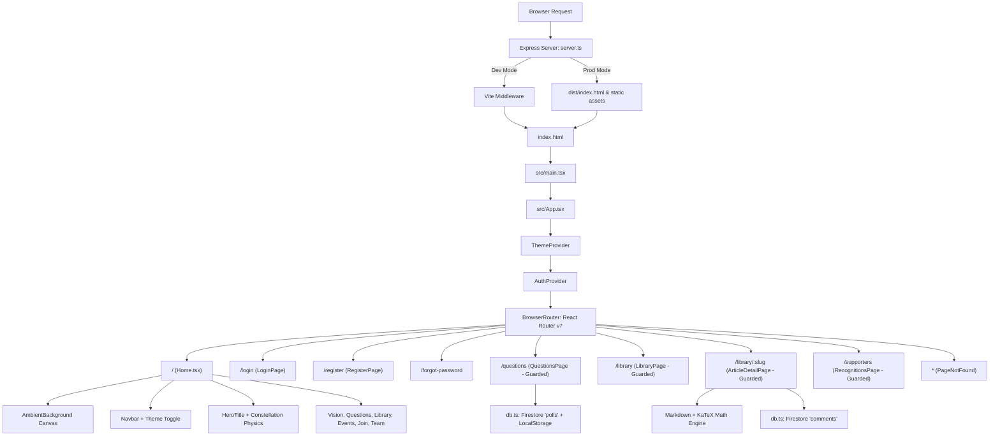

# ARCHITECTURE.md — Project Structure & Technical Architecture

## 1. Project Overview

### Framework & Technology Stack
*The Collegium of Minds* is a full-stack web application combining a React 19 single-page application (SPA) frontend with an Express + TypeScript server runtime.

- **Frontend Core:** React 19 (`react`, `react-dom`), TypeScript 5.8, Vite 6.
- **Styling System:** Tailwind CSS v4 (`tailwindcss`, `@tailwindcss/vite`) using the native `@theme` configuration block in `src/index.css`.
- **Client Routing:** React Router v7 (`react-router-dom`) with declarative browser history routing and route guards.
- **Data Fetching & Caching:** TanStack React Query v5 (`@tanstack/react-query`).
- **Database & Cloud Backend:** Firebase v12 (`firebase/app`, `firebase/firestore`) connecting to Cloud Firestore.
- **Server Runtime:** Node.js with Express 4.21, executed via `tsx` in development and bundled via `esbuild` for production.
- **Animation & Visuals:** Framer Motion (`framer-motion`, `motion`), HTML5 Canvas 2D particle simulations.
- **Rich Scientific Content:** `react-markdown`, `remark-math`, `rehype-katex`, `katex` for LaTeX mathematical rendering.
- **Icons:** Lucide React (`lucide-react`).
- **AI SDK:** Google GenAI SDK (`@google/genai` v2.4.0 declared for future server-side AI integrations).

### Main Dependencies & Roles
| Package | Version | Primary Purpose |
| :--- | :--- | :--- |
| `react` / `react-dom` | `^19.0.1` | Core UI view layer and component model |
| `vite` | `^6.2.3` | High-performance dev server, bundler, and HMR engine |
| `@tailwindcss/vite` | `^4.1.14` | Vite compiler plugin for Tailwind CSS v4 engine |
| `express` | `^4.21.2` | HTTP backend server, API router, and Vite dev middleware host |
| `firebase` | `^12.15.0` | Client Firestore SDK for live poll votes, views, likes, and comments |
| `framer-motion` | `^12.42.0` | Spring physics animations, modal entrances, and layout transitions |
| `react-router-dom` | `^7.18.0` | SPA client routing, route guards, URL parameter parsing |
| `@tanstack/react-query` | `^5.101.2` | Async server state fetching, caching, and mutation tracking |
| `katex` / `rehype-katex` | `^0.17.0` | High-fidelity scientific LaTeX mathematical expression rendering |
| `remark-math` / `react-markdown` | `^6.0.0` / `^10.1.0` | Markdown parsing with math block and inline equation support |
| `lucide-react` | `^0.546.0` | Feather-based SVG iconography across the interface |
| `esbuild` | `^0.25.0` | Blazing fast bundling of `server.ts` into `dist/server.cjs` |
| `tsx` | `^4.21.0` | Direct TypeScript execution for development server runtime |

### Application Entry Points
1. **Frontend Client Entry Point:**
   - HTML Scaffold: [index.html](file:///home/vaidikshree/Documents/ProjectCode/01%20COM%20improvemnt/thecollegiumofminds-git/index.html)
   - Bootstrapper: [src/main.tsx](file:///home/vaidikshree/Documents/ProjectCode/01%20COM%20improvemnt/thecollegiumofminds-git/src/main.tsx) (initializes React root in strict mode and imports `src/index.css`)
   - Root Container: [src/App.tsx](file:///home/vaidikshree/Documents/ProjectCode/01%20COM%20improvemnt/thecollegiumofminds-git/src/App.tsx) (assembles React Query, ThemeProvider, AuthProvider, routing table, and global toasts)
2. **Backend Server Entry Point:**
   - Server Script: [server.ts](file:///home/vaidikshree/Documents/ProjectCode/01%20COM%20improvemnt/thecollegiumofminds-git/server.ts) (configures Express, attaches Vite middleware in development or serves `dist/index.html` in production, and provides REST API endpoints).

### Build & Development Setup
Scripts configured in [package.json](file:///home/vaidikshree/Documents/ProjectCode/01%20COM%20improvemnt/thecollegiumofminds-git/package.json):
- `npm run dev`: Executes `tsx server.ts`. Runs the Express server on port 3000 with Vite integrated in middleware mode (`appType: "spa"`).
- `npm run build`: Dual compilation:
  1. `vite build` bundles the frontend client into `dist/`.
  2. `esbuild server.ts --bundle --platform=node --format=cjs --packages=external --sourcemap --outfile=dist/server.cjs` compiles the server to a standalone CommonJS bundle.
- `npm run start`: Runs `node dist/server.cjs` to start the compiled production server.
- `npm run preview`: Starts Vite's built-in preview server.
- `npm run lint`: Runs `tsc --noEmit` to validate TypeScript types without generating code.
- `npm run clean`: Removes `dist/` and any lingering `server.js` output.

---

## 2. Directory Structure

```text
thecollegiumofminds-git/
├── public/                                # Static public web assets
│   ├── team/
│   │   └── sarvesh.png                   # Team headshot for founder Sarvesh Kore
│   ├── logo.jpeg                          # Official brand emblem image
│   ├── og-image.png                       # OpenGraph social share card
│   ├── robots.txt                         # Search crawler rules (allow all)
│   └── sitemap.xml                        # XML sitemap for SEO discovery
├── src/                                   # Application source code
│   ├── api/                               # Client API abstraction layer
│   │   └── authClient.ts                  # Mock authentication & member application client
│   ├── components/                        # Reusable UI widgets & visual effects
│   │   ├── CinematicThemeOverlay.tsx     # Supernova & black hole canvas theme transition
│   │   ├── ConstellationHeading.tsx       # Text heading with cursor-reactive constellation physics
│   │   ├── FloatingBooksBackground.tsx    # 3D interactive floating books with opening covers
│   │   ├── HeroTitle.tsx                  # Specialized ConstellationHeading for hero stage
│   │   ├── TeamAvatar.tsx                 # Team member avatar with image/emoji fallback
│   │   ├── TypewriterQuestionCard.tsx     # Scroll-triggered typewriter card with flip action
│   │   └── ui.tsx                         # Reusable UI primitives (Button, Input, OTP, Toaster)
│   ├── data/                              # Static and seed application data
│   │   ├── articles.ts                    # Article catalog, excerpts, cover images, category colors
│   │   ├── events.ts                      # Event definitions (debates, seminars, salons)
│   │   ├── notebooks.ts                   # Monthly Substack CoM Notebook issues
│   │   ├── recognitions.ts                # Supporters, contributors, writers, patrons catalog
│   │   └── speakers.ts                    # Speaker biographies and speaker resolver utility
│   ├── lib/                               # Core libraries, contexts, and database connectors
│   │   ├── AuthContext.tsx                # Authentication state, login checks, redirect helpers
│   │   ├── ThemeContext.tsx               # Dark/light theme state with timed transition orchestration
│   │   ├── db.ts                          # Firestore client operations with localStorage fallbacks
│   │   └── firebase.ts                    # Firebase app and Firestore instance initialization
│   ├── pages/                             # Route view pages and major section bundles
│   │   ├── Events.tsx                     # Master-detail event assembly view (standalone page)
│   │   ├── Home.tsx                       # Primary landing page housing all major narrative sections
│   │   ├── Questions.tsx                  # Weekly inquiry polling platform with real-time stats
│   │   └── RecognitionsPage.tsx           # Contributor and supporter directory page
│   ├── App.tsx                            # Top-level routing table, providers, and library views
│   ├── index.css                          # Tailwind v4 theme configuration, fonts, and custom styles
│   ├── main.tsx                           # React DOM mount point
│   └── types.ts                           # Global TypeScript data contracts and interfaces
├── .env.example                           # Template for required environment variables
├── .gitignore                             # Git ignore rules for node_modules, build outputs, and caches
├── agent.md                               # Operational snapshot and project status overview
├── firebase-applet-config.json            # Google AI Studio / Firebase app configuration
├── firestore.rules                        # Cloud Firestore security rules
├── index.html                             # Main HTML scaffold, metadata, and font declarations
├── metadata.json                          # Applet capability metadata
├── package.json                           # Dependencies, scripts, and package metadata
├── package-lock.json                      # Pinned dependency lockfile
├── Project.md                             # Project development notes and phase tracking
├── README.md                              # Community mission statement and project introduction
├── server.ts                              # Express server with Vite middleware and JSON API routes
├── tsconfig.json                          # TypeScript compiler settings and path aliases
├── vercel.json                            # Vercel deployment rewrite rules for SPA routing
└── vite.config.ts                         # Vite configuration with Tailwind v4 and path aliases
```

---

## 3. File-by-File Responsibilities

### Root Configuration & Operational Files
- [package.json](file:///home/vaidikshree/Documents/ProjectCode/01%20COM%20improvemnt/thecollegiumofminds-git/package.json): Defines NPM project scripts, runtime dependencies (React 19, Vite, Express, Firebase, Framer Motion, KaTeX), and development dependencies.
- [tsconfig.json](file:///home/vaidikshree/Documents/ProjectCode/01%20COM%20improvemnt/thecollegiumofminds-git/tsconfig.json): Configures TypeScript for ES2022 target, bundler module resolution, JSX runtime (`react-jsx`), and path alias mapping (`@/*` to `./src/*`).
- [vite.config.ts](file:///home/vaidikshree/Documents/ProjectCode/01%20COM%20improvemnt/thecollegiumofminds-git/vite.config.ts): Configures Vite with React plugin, Tailwind CSS v4 plugin, alias resolution for `@`, and environment-sensitive HMR/watch controls.
- [server.ts](file:///home/vaidikshree/Documents/ProjectCode/01%20COM%20improvemnt/thecollegiumofminds-git/server.ts): Express HTTP server listening on port 3000. In development, it spins up Vite in middleware mode; in production, it serves precompiled assets from `dist/`. Also serves REST endpoints (`/api/likes`, `/api/questions`) with JSON file-backed persistence (`likes.json`, `questions.json`).
- [index.html](file:///home/vaidikshree/Documents/ProjectCode/01%20COM%20improvemnt/thecollegiumofminds-git/index.html): HTML5 document shell. Contains SEO metadata, Open Graph and Twitter Card tags, schema.org JSON-LD structured data, favicon link, and script mount for `/src/main.tsx`.
- [firebase-applet-config.json](file:///home/vaidikshree/Documents/ProjectCode/01%20COM%20improvemnt/thecollegiumofminds-git/firebase-applet-config.json): Credentials and IDs for the connected Firebase project (`gen-lang-client-0707635795`), database ID, and storage bucket.
- [firestore.rules](file:///home/vaidikshree/Documents/ProjectCode/01%20COM%20improvemnt/thecollegiumofminds-git/firestore.rules): Security rules for Cloud Firestore database; currently permits read and write access across all documents.
- [vercel.json](file:///home/vaidikshree/Documents/ProjectCode/01%20COM%20improvemnt/thecollegiumofminds-git/vercel.json): Configures URL rewrites (`/(.*)` -> `/`) to ensure client-side React Router functions correctly on Vercel deployments.
- [.env.example](file:///home/vaidikshree/Documents/ProjectCode/01%20COM%20improvemnt/thecollegiumofminds-git/.env.example): Documents expected runtime environment variables: `GEMINI_API_KEY` and `APP_URL`.
- [metadata.json](file:///home/vaidikshree/Documents/ProjectCode/01%20COM%20improvemnt/thecollegiumofminds-git/metadata.json): Declares application capability flags (`MAJOR_CAPABILITY_SERVER_SIDE_GEMINI_API`).
- [README.md](file:///home/vaidikshree/Documents/ProjectCode/01%20COM%20improvemnt/thecollegiumofminds-git/README.md): High-level project statement: *"The Collegium Of Minds — Think. Explore. Discover."*
- [agent.md](file:///home/vaidikshree/Documents/ProjectCode/01%20COM%20improvemnt/thecollegiumofminds-git/agent.md): Quick operational status summary for automated agents working on the codebase.
- [Project.md](file:///home/vaidikshree/Documents/ProjectCode/01%20COM%20improvemnt/thecollegiumofminds-git/Project.md): Historical attribution and roadmap notes for development phases.

### Core Source (`src/`)
- [src/main.tsx](file:///home/vaidikshree/Documents/ProjectCode/01%20COM%20improvemnt/thecollegiumofminds-git/src/main.tsx): Client entry point. Renders `<App />` inside React's `StrictMode` into the DOM `#root` container and imports `index.css`.
- [src/index.css](file:///home/vaidikshree/Documents/ProjectCode/01%20COM%20improvemnt/thecollegiumofminds-git/src/index.css): Primary stylesheet. Imports Google Fonts (Fraunces, Inter, JetBrains Mono), imports `@import "tailwindcss"`, declares the Tailwind v4 `@theme` configuration with dark/light design tokens, sets global SVG noise grain, and configures `.markdown-body` styling for math and articles.
- [src/types.ts](file:///home/vaidikshree/Documents/ProjectCode/01%20COM%20improvemnt/thecollegiumofminds-git/src/types.ts): TypeScript type definitions: `Article`, `Member`, `Society`, `Question`, `Project`, and `ClubEvent`.
- [src/App.tsx](file:///home/vaidikshree/Documents/ProjectCode/01%20COM%20improvemnt/thecollegiumofminds-git/src/App.tsx): Central application orchestrator. Houses:
  - Provider composition (`QueryClientProvider`, `ThemeProvider`, `AuthProvider`).
  - Top-level routing table and route guard wrapper (`AuthenticatedRoute`).
  - `LibraryPage`: Searchable, categorized archive of essays and monthly notebooks with custom category migration logic.
  - `ArticleDetailPage`: Full-screen reading environment with scroll progress bar, Markdown/KaTeX body rendering, Substack preview support, author signature block, newsletter subscription, and interactive quote citation generator.
  - Authentication views: `LoginPage`, `RegisterPage` (with 6-slot OTP flow), `ForgotPasswordPage`, and `PageNotFound` (404 handler).

### Components (`src/components/`)
- [CinematicThemeOverlay.tsx](file:///home/vaidikshree/Documents/ProjectCode/01%20COM%20improvemnt/thecollegiumofminds-git/src/components/CinematicThemeOverlay.tsx): Full-screen fixed canvas component that renders a cosmic animation when toggling theme:
  - Dark → Light: Supernova starburst accumulation and shockwave white-out.
  - Light → Dark: Black hole singularity formation with gravitational particle collapse.
- [ConstellationHeading.tsx](file:///home/vaidikshree/Documents/ProjectCode/01%20COM%20improvemnt/thecollegiumofminds-git/src/components/ConstellationHeading.tsx): Advanced typographical component. Samples letter coordinates onto an offscreen canvas and renders dual text layers; hovering masks out the solid fill and renders interactive constellation stars and linking lines.
- [HeroTitle.tsx](file:///home/vaidikshree/Documents/ProjectCode/01%20COM%20improvemnt/thecollegiumofminds-git/src/components/HeroTitle.tsx): Pre-configured instance of `ConstellationHeading` customized for the landing page hero title.
- [FloatingBooksBackground.tsx](file:///home/vaidikshree/Documents/ProjectCode/01%20COM%20improvemnt/thecollegiumofminds-git/src/components/FloatingBooksBackground.tsx): Ambient 3D background containing 10 floating classic books. Features cursor-responsive 3D tilt and an animated front cover that swings open (`rotateY(-135deg)`) on hover to reveal author and title.
- [TeamAvatar.tsx](file:///home/vaidikshree/Documents/ProjectCode/01%20COM%20improvemnt/thecollegiumofminds-git/src/components/TeamAvatar.tsx): Reusable avatar container that renders a photograph with bronze gradient border or falls back to an emoji symbol.
- [TypewriterQuestionCard.tsx](file:///home/vaidikshree/Documents/ProjectCode/01%20COM%20improvemnt/thecollegiumofminds-git/src/components/TypewriterQuestionCard.tsx): Interactive card that types out philosophical questions character-by-character when scrolled into view and supports click-to-flip question cycling.
- [ui.tsx](file:///home/vaidikshree/Documents/ProjectCode/01%20COM%20improvemnt/thecollegiumofminds-git/src/components/ui.tsx): Core design system primitives:
  - `Button`: Supports `default`, `outline`, `ghost`, and `destructive` variants.
  - `Input`: High-contrast form text field.
  - `Label`: Uppercase tracking-spaced form label.
  - `InputOTP`, `InputOTPGroup`, `InputOTPSlot`: 6-digit verification code input.
  - `Toaster` and `toast()`: Lightweight custom toast notification system with automatic timer dismissal.

### Pages (`src/pages/`)
- [Home.tsx](file:///home/vaidikshree/Documents/ProjectCode/01%20COM%20improvemnt/thecollegiumofminds-git/src/pages/Home.tsx): The central landing page comprising interconnected narrative sections:
  - `AmbientBackground`: Starry canvas with floating mathematical symbols and mouse repulsion physics.
  - `Navbar`: Sticky responsive navigation with smooth hash-scrolling, mobile menu drawer, and theme switch.
  - `HeroSection`: HeroTitle, manifesto quote, and dual action CTAs.
  - `StatsStrip`: Real-time counter metrics for questions, readers, and members.
  - `VisionSection`: The core philosophy, purpose, and community ethos.
  - `AboutSection`: Origins, interdisciplinary mission, and historical background.
  - `QuestionsSection`: Interactive inquiry platform with typewriter question cards.
  - `DiscussionsSection`: Highlighting active topics and community conversations.
  - `LibrarySection`: Featured articles, category browsing, and Substack integration.
  - `NewsletterSection`: Direct enrollment for the Substack newsletter.
  - `EventsSection`: Interactive schedule of seminars, debates, and salons with speaker resolution.
  - `JoinSection`: Fellowship application instructions with Google Form links and guidelines.
  - `RecognitionSection`: Showcase of patrons, founders, writers, and community leaders.
  - `TeamSection`: Core leadership council profiles and social links.
  - `Footer`: Site index, copyright, and external platform links.
- [Events.tsx](file:///home/vaidikshree/Documents/ProjectCode/01%20COM%20improvemnt/thecollegiumofminds-git/src/pages/Events.tsx): Standalone master-detail assembly page for browsing past and upcoming events with real-time text search, type filters, status tabs, and a detailed modal for speaker biographies. *(See Section 6 for routing notes).*
- [Questions.tsx](file:///home/vaidikshree/Documents/ProjectCode/01%20COM%20improvemnt/thecollegiumofminds-git/src/pages/Questions.tsx): Dedicated inquiry page housing the *Question of the Week*. Features live voting, percentage calculation bars, vote retraction capability, Discord community invitation, and synchronization with Firestore/localStorage.
- [RecognitionsPage.tsx](file:///home/vaidikshree/Documents/ProjectCode/01%20COM%20improvemnt/thecollegiumofminds-git/src/pages/RecognitionsPage.tsx): Dedicated directory mounted at `/supporters`. Features badge-based filtering ('Founder', 'Writer', 'Community', 'Patron', etc.), toggleable search bar, and social profile links.

### Data & Static Collections (`src/data/`)
- [articles.ts](file:///home/vaidikshree/Documents/ProjectCode/01%20COM%20improvemnt/thecollegiumofminds-git/src/data/articles.ts): Contains the `articles` catalog (with markdown content, excerpts, read times, slugs, Substack links, and cover images) along with the `categoryColors` dictionary defining colors, badges, and glow styling for all 9 disciplines.
- [events.ts](file:///home/vaidikshree/Documents/ProjectCode/01%20COM%20improvemnt/thecollegiumofminds-git/src/data/events.ts): Defines structured event data: title, type (Debate, Seminar, Workshop, Salon, Symposium, Initiative), date, time, location, emoji, summary, description, and status.
- [notebooks.ts](file:///home/vaidikshree/Documents/ProjectCode/01%20COM%20improvemnt/thecollegiumofminds-git/src/data/notebooks.ts): Curated list of monthly *CoM Notebook* issues published on Substack with edition titles, descriptions, and links.
- [recognitions.ts](file:///home/vaidikshree/Documents/ProjectCode/01%20COM%20improvemnt/thecollegiumofminds-git/src/data/recognitions.ts): Contributor profiles with roles, contribution justifications, badges, and social media URLs.
- [speakers.ts](file:///home/vaidikshree/Documents/ProjectCode/01%20COM%20improvemnt/thecollegiumofminds-git/src/data/speakers.ts): Dictionary of speaker biographies, avatars, and quotes, along with `resolveSpeakers()`, a parser that extracts individual speaker profiles from composite event presenter strings (e.g., "A & B" or "Hosted by X").

### Libraries & Backend Connectors (`src/lib/`, `src/api/`)
- [firebase.ts](file:///home/vaidikshree/Documents/ProjectCode/01%20COM%20improvemnt/thecollegiumofminds-git/src/lib/firebase.ts): Initializes the Firebase App instance and exports the Firestore database reference `db` bound to database `ai-studio-thecollegiumofmi-626fb95a-eb28-4e68-ae3f-7db91987bcbb`.
- [db.ts](file:///home/vaidikshree/Documents/ProjectCode/01%20COM%20improvemnt/thecollegiumofminds-git/src/lib/db.ts): Firestore client wrapper that manages:
  1. `getPollVotes()`, `submitVote()`, `retractVote()` (using Firestore transactions on the `polls` collection with resilient localStorage fallbacks).
  2. `getPageViews()`, `incrementPageViews()` (atomic increments on document `stats/page_views`).
  3. `getArticleLikes()`, `incrementArticleLike()` (tracking likes per article slug in `article_likes`).
  4. `getArticleComments()`, `addArticleComment()`, `deleteArticleComment()` (chronological commentary ledger stored in `comments`).
  5. `getOrCreateUserId()` generating a stable pseudo-anonymous user ID in localStorage (`com_userId`) to allow users to manage their own comments.
- [AuthContext.tsx](file:///home/vaidikshree/Documents/ProjectCode/01%20COM%20improvemnt/thecollegiumofminds-git/src/lib/AuthContext.tsx): React Context providing `user`, `isAuthenticated`, `isLoadingAuth`, `navigateToLogin`, and `logout`.
- [ThemeContext.tsx](file:///home/vaidikshree/Documents/ProjectCode/01%20COM%20improvemnt/thecollegiumofminds-git/src/lib/ThemeContext.tsx): React Context managing the dark/light theme state, synchronizing the `.light` class on `document.documentElement`, and scheduling the 1300ms cinematic transition with a peak theme swap at 650ms.
- [authClient.ts](file:///home/vaidikshree/Documents/ProjectCode/01%20COM%20improvemnt/thecollegiumofminds-git/src/api/authClient.ts): Client authentication adapter. Simulates authentication operations against localStorage (`com_users`, `com_current_user`), provides OTP generation and verification, and includes an auto-authentication fallback in `authClient.auth.me()` that provisions a default admin session so visitors can explore guarded sections without encountering abrupt login blockers.

---

## 4. Application Flow



### Component Hierarchy & Provider Stack
1. `QueryClientProvider` (TanStack React Query client cache)
2. `ThemeProvider` (Theme mode state & transition timer)
3. `AuthProvider` (User identity & session verification)
4. `CinematicThemeOverlay` (Fixed canvas rendering supernova / black hole transitions)
5. `BrowserRouter` (`Router`)
   - `ScrollToTop` (Resets window position to top on navigation, handles smooth anchor jumping)
   - `Routes` (Route mapping and route guards)
   - `Toaster` (Fixed bottom-right notification stack)

### State Management Strategy
- **Global Theme State:** Managed via `ThemeContext` and persisted in `localStorage('com_theme')`.
- **Global Auth State:** Managed via `AuthContext` and verified on boot via `authClient.auth.me()`.
- **Async Server State:** Cached and coordinated using React Query (`useQuery`) for server and auth checks.
- **Persistent Interaction State:**
  - Poll votes, article likes, user-submitted articles, and comments synchronize between Firestore and browser `localStorage`.
  - User ID generation (`com_userId`) persists locally to enable deletion of one's own comments.
- **Local Component State:** Search queries, active tab selections, modal visibility, and canvas mouse coordinates.

### External Services & Integrations
- **Cloud Firestore:** Primary persistence layer for community interactions (polls, likes, comments, page views).
- **Substack:** Official host for the *CoM Notebook* monthly publication and syndicated articles.
- **Google Forms:** Application submission portal for prospective fellowship members.
- **Discord:** Real-time scholarly community and debate auditorium.
- **KaTeX:** High-speed client-side rendering of mathematical expressions in articles.

---

## 5. Dependencies & Configuration Details

### [vite.config.ts](file:///home/vaidikshree/Documents/ProjectCode/01%20COM%20improvemnt/thecollegiumofminds-git/vite.config.ts)
- Configures `@tailwindcss/vite` and `@vitejs/plugin-react`.
- Defines path alias `@` pointing to `./src`.
- Respects `DISABLE_HMR` environment variable to disable file-watching and hot module reloading during automated agent operations.

### [tsconfig.json](file:///home/vaidikshree/Documents/ProjectCode/01%20COM%20improvemnt/thecollegiumofminds-git/tsconfig.json)
- Target: `ES2022` with `DOM` and `DOM.Iterable` libraries.
- Bundler module resolution (`"moduleResolution": "bundler"`, `"module": "ESNext"`).
- Path mapping for `@/*`.
- Configured with `"noEmit": true` since bundling is handled by Vite and esbuild.

### [vercel.json](file:///home/vaidikshree/Documents/ProjectCode/01%20COM%20improvemnt/thecollegiumofminds-git/vercel.json)
- Defines a single URL rewrite mapping all requests (`/(.*)`) to the root index (`/`), enabling client-side routing on Vercel without 404 errors.

### [firestore.rules](file:///home/vaidikshree/Documents/ProjectCode/01%20COM%20improvemnt/thecollegiumofminds-git/firestore.rules)
- Specifies `rules_version = '2'`.
- Matches all documents (`match /{document=**}`) with `allow read, write: if true;`, facilitating rapid community interactions without mandatory server-side user tokens.

---

## 6. Development Guidelines

### Where to Add New Features
| Objective | Location / Approach |
| :--- | :--- |
| **Add a New Page** | 1. Create page component in `src/pages/MyNewPage.tsx`.<br>2. Register route in `src/App.tsx` `<Routes>`.<br>3. Wrap with `<AuthenticatedRoute>` if access should be restricted to members.<br>4. Add navigation link in `Navbar` inside `src/pages/Home.tsx`. |
| **Add a Reusable Component** | Create in `src/components/MyComponent.tsx`. Follow styling rules from `DESIGN.md`. If it is a generic form primitive, place it in `src/components/ui.tsx`. |
| **Publish an Article** | Append article object to `articles` in `src/data/articles.ts`. Set `category` to one of the 9 defined disciplines to inherit automatic chromatic branding. |
| **Add an Event** | Add event object to `eventsData` in `src/data/events.ts`. Specify `speaker`, `status` (`upcoming` \| `completed`), and `type`. |
| **Add a Speaker Profile** | Add speaker details to `speakerDetails` in `src/data/speakers.ts`. |
| **Modify Styles or Tokens** | Modify `@theme` in `src/index.css`. Maintain aliases for existing tokens to avoid layout regressions. |
| **Add Firestore Collections** | Add strongly-typed helper functions in `src/lib/db.ts` using exports from `src/lib/firebase.ts`. Always provide a fallback path in case Firestore encounters network latency or offline mode. |

---

## 7. Known Architectural Nuances & Unmounted Areas

To ensure complete accuracy for future developers and AI agents, the following items reflect the actual state of the repository:

1. **`src/pages/Events.tsx` Routing Status:**
   `EventsPage` is fully implemented in `src/pages/Events.tsx` with search, category filtering, and modal capabilities, and is imported in `src/App.tsx`. However, it is not currently registered in the `<Routes>` block of `App.tsx`. The primary interface for events currently experienced by users is the `EventsSection` embedded directly within `src/pages/Home.tsx`. If a standalone `/events` route is desired in the future, it can be mounted directly in `App.tsx`.

2. **Dual Data Persistence Paths:**
   - Client-side interactions (polls, article likes, comments, page views) communicate directly with Google Cloud Firestore via `src/lib/db.ts`.
   - The Express server in `server.ts` also exposes standalone REST endpoints (`/api/likes`, `/api/questions`) backed by local JSON files (`likes.json`, `questions.json`). The frontend currently uses the Firestore client for live interactions, while the Express routes serve as an alternative local data path.

3. **Authentication Default Behavior:**
   `src/api/authClient.ts` provides a complete local mock authentication layer with email/password checks, 6-digit OTP verification, and password resets. In `authClient.auth.me()`, if no user is found in `localStorage`, it automatically seeds a default administrative session (`ssworld7105@gmail.com`). This intentional mechanism ensures that routes wrapped in `AuthenticatedRoute` remain accessible to visitors and reviewers while retaining the ability to test real login and logout flows.

4. **AI SDK Integration:**
   `@google/genai` is installed as a dependency in `package.json` and declared in `metadata.json` (`MAJOR_CAPABILITY_SERVER_SIDE_GEMINI_API`) and `.env.example`. Explicit server routes calling Gemini models are not yet bound in `server.ts` and represent a ready extension point for future AI-driven features (e.g., automated question generation, semantic article summarization).
